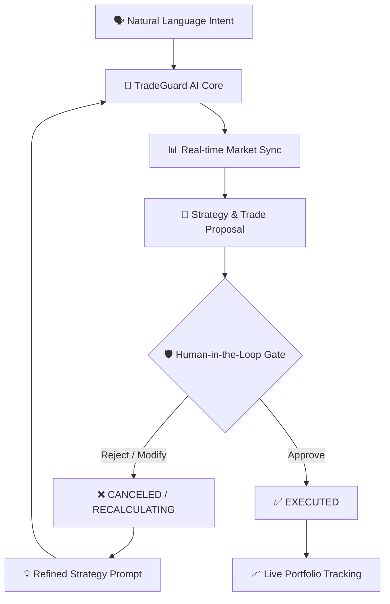

<div align="center">

# 🛡️ TradeGuard

### **Trade at the speed of thought**

**An AI-powered trading copilot that understands your natural language intent, parses market data in real-time, and proposes surgical trades—but never executes without your explicit approval.**

<br/>

```text
Intent Parsing  →  Market Analysis  →  Trade Generation  →  User Approval  →  Execution
```

<br/>

[](#tech-stack)
[](#tech-stack)
[](#tech-stack)
[](#ai-copilot-architecture)
[](#execution-decision-model)

<br/>

</div>

---

## ⚡ Key Highlights

<table>
<tr>
<td width="25%" align="center">
<h3>🧠 Intent Parsing</h3>
<p>Instantly converts natural language strategies into actionable, structured trade setups in under 12ms.</p>
</td>
<td width="25%" align="center">
<h3>🛡️ Human-in-the-Loop</h3>
<p>The AI acts as your copilot. It proposes the optimal trade but strictly requires your explicit approval.</p>
</td>
<td width="25%" align="center">
<h3>🌐 Immersive 3D Markets</h3>
<p>Real-time visualization of market state utilizing Three.js and React Three Fiber for deep market context.</p>
</td>
<td width="25%" align="center">
<h3>🔒 Secure Execution</h3>
<p>Isolated environments and verified connections ensure your trades are executed flawlessly and safely.</p>
</td>
</tr>
</table>

---

## 🛑 The Problem

> ### *"Trading platforms are too complex, but autonomous bots are too dangerous."*

Speed is everything in modern trading, but traditional platforms slow you down with dense UIs and menus. Conversely, handing full control to automated bots in volatile markets often leads to catastrophic, unsupervised losses:

```
❌ Missed entry points due to complex multi-step order screens
❌ "Black box" trading algorithms executing without human oversight
❌ Lack of situational awareness in flat, 2D data interfaces
❌ High latency between forming a strategy and actual execution
```

**TradeGuard provides the perfect balance:** combining the lightning-fast speed of AI intent parsing with the absolute safety of explicit human approval.

---

## 🔄 How It Works



---

## 🛠️ Execution in Action: Before & After Approval

TradeGuard parses complex conditional logic and sets up the precise order parameters. It packages the execution plan into an immutable context card for your final review.

<table>
<tr>
<th width="50%">1. Intent Parsing (AI Setup)</th>
<th width="50%">2. After User Approval</th>
</tr>
<tr>
<td valign="top">

```yaml
Intent: "Buy 100 NIFTY 50 if price drops below 22,400"
Status: AWAITING AUTHORIZATION
Latency: 12ms
Action: BUY LIMIT
```

```json
{
  "symbol": "NIFTY 50",
  "quantity": 100,
  "orderType": "LIMIT",
  "limitPrice": 22400.00,
  "timeInForce": "DAY"
}
```

🚨 **Outcome:** Trade configured instantly. Waiting for your one-click approval.
</td>
<td valign="top">

```yaml
Intent: "Buy 100 NIFTY 50 if price drops below 22,400"
Status: EXECUTED
Latency: 8ms
Action: ORDER PLACED
```

```diff
- Status: AWAITING AUTHORIZATION
+ Status: VERIFIED & EXECUTED
```

✅ **Outcome:** Order successfully pushed to the exchange with zero manual data entry.
</td>
</tr>
</table>

> [!IMPORTANT]
> **Separation of Concerns:** TradeGuard's AI handles the heavy lifting of parsing, calculating risk, and structuring the order; **You maintain absolute control** over the final execution decision.

---

## 🚀 See the Full Workflow

```text
Natural Language ➔ AI Parsing ➔ Market Sync ➔ Trade Proposal ➔ Explicit Approval ➔ Order Executed
```

Dive into the immersive 3D terminal and experience trading at the speed of thought.

---

<br/>

## 🔬 Technical Deep Dive

---

### 1. Immersive UI Architecture

TradeGuard breaks away from traditional flat tables, utilizing a multi-layered rendering engine:

1. **3D Core Layer:** Leverages `@react-three/fiber` and `@react-three/drei` to render spatial market data, giving you a visceral sense of market depth and volatility.
2. **Glassmorphism UI:** Built with TailwindCSS and custom CSS variables (`--base-bg`, `--ai-primary`) to create a floating, HUD-like interface that doesn't obstruct the market view.
3. **Micro-Interactions:** `framer-motion` and `gsap` drive fluid transitions, status pulses, and cinematic enter animations, keeping the user engaged without fatigue.

---

### 2. Execution Decision Model

TradeGuard enforces strict, predictable order gating:

| Decision State | Trigger Conditions | Meaning |
| :--- | :--- | :--- |
| **`AWAITING AUTHORIZATION`** | • AI has parsed the intent<br/>• Order parameters are staged | The copilot has prepared the trade and is waiting for human confirmation. |
| **`RECALCULATING`** | • User rejected the proposal<br/>• User provided a natural language correction | The AI is adjusting the parameters based on your feedback. |
| **`EXECUTED`** | • User explicitly clicked Approve<br/>• Market conditions validate the order | The trade is pushed to the exchange securely. |

> [!NOTE]
> **AI as an Advisor:** The AI model (TradeGuard-Alpha) has absolutely zero direct access to the execution layer. The UI explicitly gates the API call behind your physical click.

---

### 3. Tech Stack

| Layer | Technologies |
| :--- | :--- |
| **Frontend Framework** | React 19, Vite, TypeScript |
| **Styling & UI** | TailwindCSS, `clsx`, `tailwind-merge`, Lucide React |
| **Animations** | Framer Motion, GSAP |
| **3D Engine** | Three.js, React Three Fiber, Drei |
| **Code Quality** | Oxlint (ultra-fast Rust-based linter) |

---

### 4. Running Locally

#### Prerequisites
- **Node.js**: v18.0.0 or higher (v20+ recommended)
- **npm**: v9.0.0 or higher

#### Quickstart

```bash
# Install dependencies
npm install

# Start the development server
npm run dev
```

Open **http://localhost:5173** in your browser to enter the copilot.

---

<div align="center">

# TradeGuard

### **Trade at the speed of thought.**

</div>
